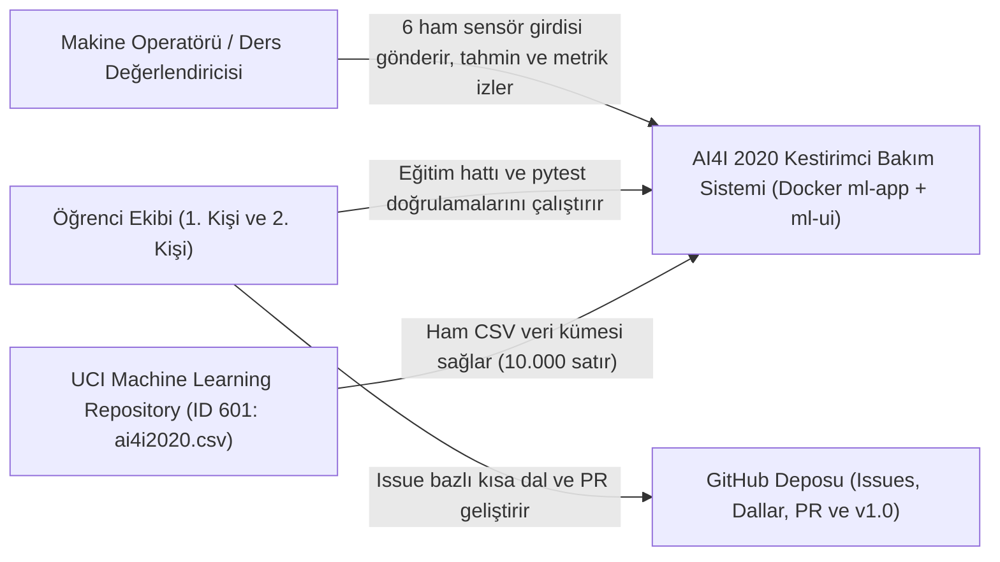
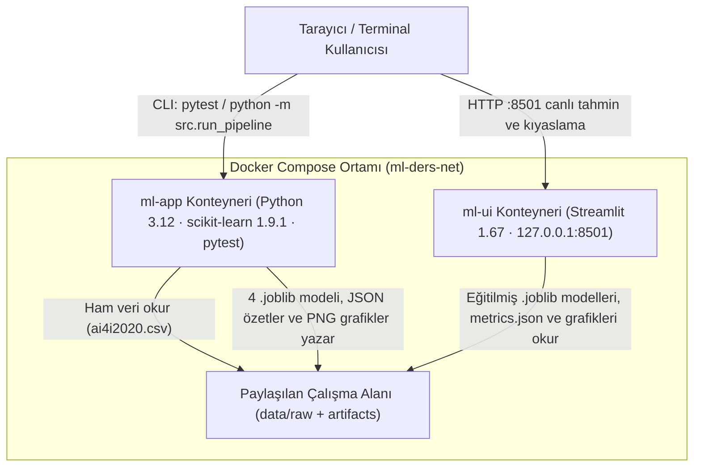
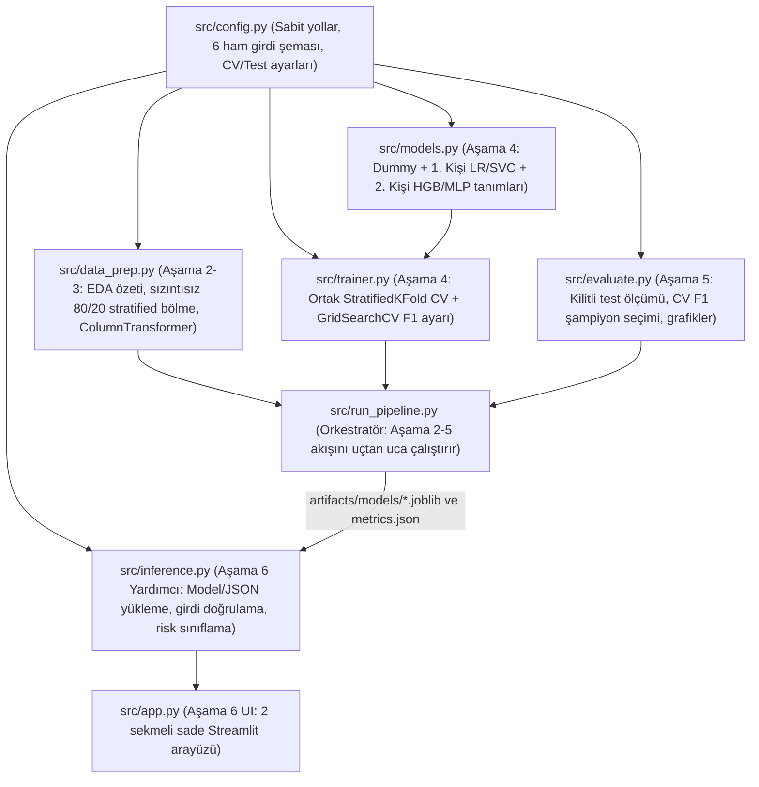
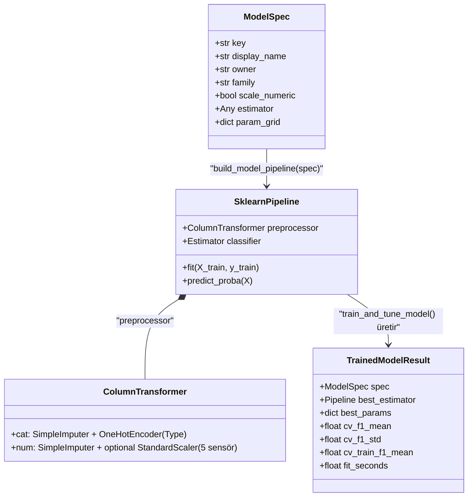

# C4 Mimari Diyagramları (C1–C4)

Bu doküman, **AI4I 2020 Kestirimci Bakım** uygulamasının yazılım mimarisini Simon Brown'un **C4 Modeli** kapsamındaki dört seviyede (**C1 Sistem Bağlamı**, **C2 Konteyner**, **C3 Bileşen** ve **C4 Kod**) belgeler.

> [!NOTE]
> Bu projede kod tabanı 8 küçük Python modülünden oluştuğu için C1–C3 seviyelerine ek olarak çekirdek `Pipeline` ve veri sözleşmelerini özetleyen C4 (Kod) seviyesi de uygulanabilir bulunmuş ve eklenmiştir.

---

## C1 — Sistem Bağlamı (System Context)

Kullanıcı rolleri, kapsamdaki ML sistemi ve harici veri/sürüm kaynakları arasındaki ilişkiyi gösterir.

---

## C2 — Konteyner Diyagramı (Container)

Tüm çalışma zamanı **Docker Compose** (`compose.yaml`) içindeki Python 3.12 imajı (`ml-ders-projesi:py3.12`) ve paylaşılan yerel birim (`ml_proje/:/app`) üzerinden yürür; yerel makineye Python paketi kurulmaz.

---

## C3 — Bileşen Diyagramı (Component — `ml_proje/src/`)

`src/` altındaki modüllerin **CRISP-DM 6 Aşamalı Eğitim Süreci** ile birebir eşleşimini gösterir.

---

## C4 — Kod Düzeyi (Code — Çekirdek Veri Sözleşmeleri ve `Pipeline` Yapısı)

Model adaylarını tanımlayan `ModelSpec`, eğitim çıktısı `TrainedModelResult` ve her algoritmayı veri sızıntısından koruyan `Pipeline` iç kompozisyonunu özetler.

